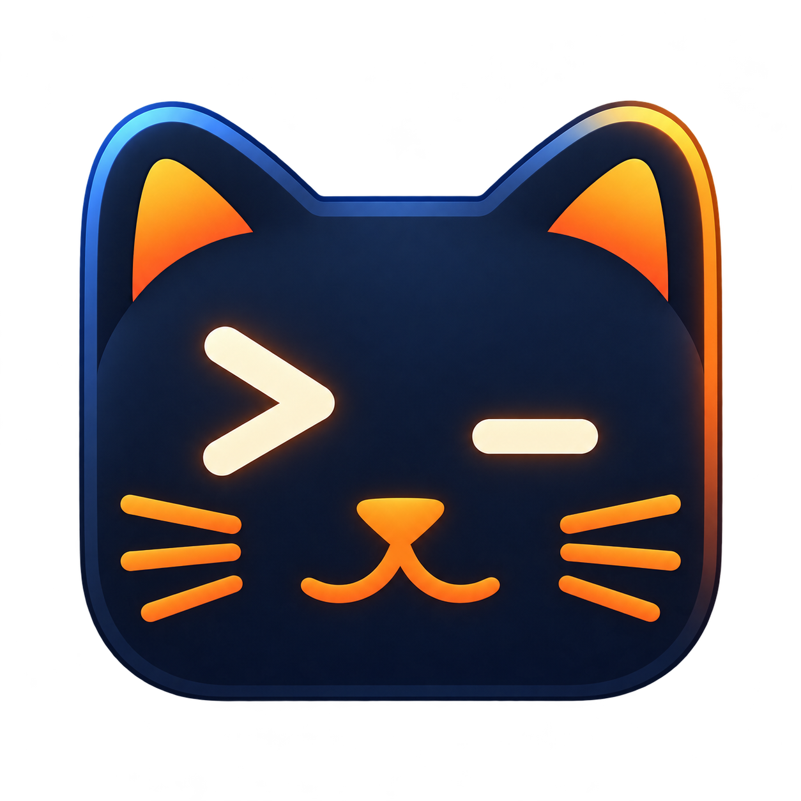

<p align="center"></p>

# AkiTTY

### The Agent-Native Terminal

**See agent activity. Approve command requests. Stay in charge.**

AkiTTY is a native macOS terminal for developers working with AI coding agents.
See what participating agents report across your terminals, review commands they
ask AkiTTY to dispatch, and take back terminal input when you need it.

Bring your own agent and keep your ordinary shell workflow. No specific AI
provider, cloud account or AX product is required.

**Apple Silicon · macOS 14+ · MIT licensed**

[Install AkiTTY](#quick-start) · [Try the workflow](#try-the-agent-workflow) ·
[Release notes](docs/releases/1.3.2.md) · [Agent integration guide](docs/AGENT_NATIVE.md)

For Windows and Linux, see the separate [AkiTTY Web terminal](#windows-and-linux).

> Only commands submitted through the opt-in request interface use the native
> human approval workflow. Ordinary agent subprocesses are not intercepted.
> Activity reports are supplied by programs, not verified execution results.

## Why AkiTTY?

When agents work in several tabs or panes, following their output is only part
of the job. You also need to see which ones report work or need attention, review
requests to use a terminal, and know who currently owns its input.

AkiTTY brings those tasks into one native workflow:

| Capability | What you can do |
| --- | --- |
| **Observe** | Open Agent Overview to see reported activity and input ownership across windows, tabs, split panes and the hidden quick terminal. |
| **Approve** | Review the exact command and target terminal in a native sheet before a local agent request is dispatched. Deny is the default. |
| **Reclaim** | Take back terminal input and revoke unused approvals. Running processes continue; interrupt them separately if needed. |
| **Inspect** | Review a local timeline of activity and request metadata, with source labels and JSONL export for diagnostics. |

Already using Ghostty, Kitty, iTerm2 or Warp with a coding agent? AkiTTY is worth
trying if you want this combination of external-agent visibility, explicit input
ownership and human-approved command requests. Status reporting and automation
are not exclusive to AkiTTY; its focus is bringing them together around agents
you choose. It does not provide a built-in coding agent or replace your agent's
own permissions.

## 30-second tour

After [installing AkiTTY](#quick-start), the workflow is:

1. **See who needs attention.** Open **Window → Agent Overview (⌥⌘A)** to see
   panes together, with program reports separate from host input ownership.
2. **Review a request.** Enable local requests and have an agent submit a command
   through `akitty-agent`. A native sheet lets you approve or deny it.
3. **Take input back.** Choose **Edit → Reclaim Terminal Control**, or use
   **Reclaim Control** in Agent Overview.
4. **Inspect the record.** Choose **Akitty → Agent Event Timeline** or
   **Export Agent Events…** to review retained metadata.

[Try the steps below](#try-the-agent-workflow) with a simulated activity report
and a harmless `pwd` request. An agent must explicitly use these integration
paths; launching an ordinary CLI alone does not add activity reporting or approval.

## Quick start

Requires an **Apple Silicon Mac running macOS 14 or later**.

```sh
curl -fsSL https://download.automatosx.com/akitty/install -o install.sh
bash install.sh
open "$HOME/Applications/Akitty.app"
```

The installer downloads the latest release, verifies its checksum, code signature
and notarization, then installs it into `~/Applications`.

Click **+** or press **⌘T** for a new terminal tab. Open **Settings… (⌘,)** to
choose your font, shell and starting directory.

Updates appear as a quiet reminder in the title bar. Use **AkiTTY → Check for
Updates…** to check manually; you choose when to install and restart. Automatic
checks can be changed in Settings.

For a shared installation in `/Applications`, run the downloaded installer with
`bash install.sh --system` instead; that directory must be writable.

## Manual download

You can also [download the latest published release](https://github.com/defai-digital/akitty/releases/latest).
Choose the macOS arm64 ZIP, unzip it, move **Akitty.app** into **Applications**, and open it.

## Works with your AI agents

Keep using Claude Code, Codex, OpenCode or another coding agent in a normal shell.
For AkiTTY-specific workflows, the agent or an adapter must opt in:

| Goal | Integration path |
| --- | --- |
| Report work, waiting, completion or errors | Emit OSC 7501 program status through the terminal output stream. |
| Show a tab sprite, activity mark and pane status/progress | Use OSC 771 directly or the dependency-free [TypeScript/JavaScript SDK](packages/akitty-sdk/README.md). |
| Ask to run a command in a native terminal pane | Invoke the bundled `akitty-agent` client after the user enables local requests. Every command needs human approval. |
| Embed terminal control in your own application | Use the [trusted host API](docs/AGENT_WORKFLOWS.md#host-control-and-approval) and supply caller authentication and approval policy. |

These are integration paths, not bundled or vendor-certified connectors. An
agent's normal subprocesses and file tools remain governed by that agent and
the operating system. SDK capability detection disables presentation updates
through SSH and multiplexers unless the host explicitly integrates them.

For example, give an agent that can invoke local tools this instruction after
completing the setup below:

> Use the bundled AkiTTY `akitty-agent` client to list panes. Ask me which idle
> pane to target, then request `pwd` there and wait for native approval. Report
> the dispatch receipt without treating it as proof of success. Do not resubmit
> automatically after an uncertain response.

## Try the agent workflow

### Observe a program report

In an AkiTTY pane, run this example, then open **Agent Overview (⌥⌘A)**. It
simulates a participating program reporting work, then completion:

```sh
{
  printf '\033]7501;state=working:app=demo\007'
  sleep 5
  printf '\033]7501;state=done:app=demo\007'
}
```

The pane status and tab indicator reflect these reports. They do not prove
that useful work occurred. **Allow programs to set the status bar** must be
on in Settings (the default).

### Approve a command and reclaim input

1. Leave a local bash/zsh pane at an empty prompt, with shell integration enabled
   (the default). This is the **target**; a running TUI is not a supported target.
2. Choose **Akitty → Enable Local Agent Requests**. Requests are off at every
   app launch, so enabling them is an explicit choice for that run.
3. Open a **second pane** with **⌘D**, or use another terminal, to run the client.
   Keep the target idle while the request waits:

   ```sh
   AKITTY_AGENT="$HOME/Applications/Akitty.app/Contents/MacOS/akitty-agent"
   "$AKITTY_AGENT" list
   # Replace <pane-id> with the target's opaque pane value from the list.
   "$AKITTY_AGENT" request '<pane-id>' 'pwd'
   ```

   If installed system-wide, use `/Applications/Akitty.app/Contents/MacOS/akitty-agent`.
   If the list has an integer `next_offset`, run `"$AKITTY_AGENT" list <offset>`
   for the next page. Pane IDs change when AkiTTY restarts.
4. Review the exact command, target and shell-reported directory in the native
   sheet. Approve to dispatch once, or deny to leave it unexecuted through this path.
5. Inspect the target terminal. An accepted receipt means input was queued,
   not that `pwd` succeeded. Choose **Edit → Reclaim Terminal Control** to type
   there again. Reclaim does not stop a running command.
6. Open **Akitty → Agent Event Timeline** to inspect the request and control
   events, or **Export Agent Events…** to save JSONL metadata.

The [native agent guide](docs/AGENT_NATIVE.md) documents request limits, failure
handling and event retention. A response lost after dispatch can mean the command
already ran; inspect the terminal before making another request.

## Agent protocols

The native app keeps reported activity separate from command authority:

- **OSC 7501 revision 0.4** reports `idle`, `working`, `blocked`, `done` and `error`,
  with hierarchy and progress. It cannot grant input ownership or approve commands.
- **OSC 771** supplies small animated sprites, activity marks and completion
  indicators in tabs, with status text and progress in the pane. The
  [terminal SDK](packages/akitty-sdk/README.md) writes it through the program's
  existing serialized stdout writer; no status-bar Python script is needed.
- **`akitty-agent`** uses an opt-in same-user local socket to request native
  approval. It does not expose the privileged core control API to terminal programs.

See the [protocol and ABI contract](docs/ABI.md),
[native request and event contracts](docs/AGENT_NATIVE.md), and
[embedding host workflow](docs/AGENT_WORKFLOWS.md).

## Architecture and security boundaries

| Component | Technology |
| --- | --- |
| AkiTTY native Mac app | AkiTTY-maintained Alacritty terminal engine, Rust PTYs, Swift/AppKit UI, CoreText/Metal rendering and a bundled TypeScript command palette |
| AkiTTY Web (separate package) | Ghostty VT parser compiled to WebAssembly + Canvas rendering; the embedding host owns the PTY |

Ghostty informed the native app's design and served as a source reference. The
Mac app does not use Ghostty's Zig core or renderer, and does not inherit their
performance characteristics. The native app needs no Zig compiler or runtime;
Zig is only needed to rebuild the Web package's prebuilt wasm. Native and Web
features require separate integration and qualification.

- **Approval has a defined scope.** Each local request needs human approval bound
  to the exact command, session lease and reported directory. Commands use the
  shell's existing OS permissions; this is not an execution sandbox.
- **Reclaim controls input.** It revokes the lease and unused authorization. It
  does not undo a command, terminate a process or reverse file changes.
- **Reports have sources, not execution guarantees.** Program activity and shell
  metadata can be forged by programs in the PTY. An input-dispatch receipt is not
  a verified command result.
- **Events support inspection.** The local store retains two segments of at most
  4 MiB each, with source and loss markers. It stores command hashes and lengths,
  not command text or terminal output. Records are locally editable, can miss
  intermediate reports, and are neither a complete transcript nor tamper-proof
  evidence. Hashes are not strong secret anonymization.
- **The app keeps narrow local boundaries.** Local requests create no TCP/HTTP
  listener. Terminal clipboard reads receive an empty reply; text writes require
  approval. The bundled TypeScript palette has no shell, filesystem or network
  bridge and loads no arbitrary user JavaScript.

Read [architecture](docs/ARCHITECTURE.md) and the
[native trust boundary](docs/AGENT_NATIVE.md#local-request-protocol-and-trust-boundary)
for implementation details.

## What is implemented

- Native windows, tabs and split panes with interactive login shells; a visible
  **+** opens a new tab. Normal shell exit closes its pane, then any empty tab/window.
- Bash/zsh shell integration records bounded command observations without editing
  startup files. A persistent quick terminal has an opt-in global shortcut; hiding
  it preserves its shell. File drops insert shell-quoted paths, and text drops use
  the clipboard confirmation policy.
- Opening a folder (Finder **Open With**, a Dock drop, or `open -a Akitty <folder>`) starts
  a window in that folder; a file opens in its folder. A new tab opens after the current tab,
  in the focused pane's reported directory when that path still exists, and in the opened
  folder otherwise. Splits start in the opened folder.
- Native **Settings… (⌘,)** for font/size, a separate CJK font, shell, starting directory, scrollback,
  Option-as-Alt and update checks. Appearance changes apply to open terminals;
  shell, directory and scrollback changes apply to new terminals. Any installed fixed-pitch font can be chosen.
- Rust-owned PTYs, bounded input, terminal parsing, configurable scrollback (5,000 lines by default), alternate
  screens, ANSI/truecolor output, Unicode cell widths and selection.
- CoreText text rasterization and Metal presentation, with visible software
  fallback when Metal fails. Snapshot processing and rasterization run off the UI thread.
- Box drawing, block elements and braille (U+2500–U+259F, U+2800–U+28FF) are drawn from geometry to the exact cell,
  so borders, tables and block graphics join across rows without gaps.
- Chinese, Japanese and Korean text on a two-column grid: the CJK font follows the system language (or the CJK font
  setting) so unified Han characters take regional shapes, and wide glyphs are centred and fitted inside their cells.
  Emoji ZWJ sequences and flags are drawn as one glyph; layout stays on wcwidth rules (grapheme-cluster mode 2027 is
  reported as unsupported), so cursor maths in apps stays aligned.
- IME marked text, accessible terminal text/selection, text copy/paste, clipboard
  write approval, scrollback search and font-size controls.
- SGR and legacy mouse reporting; hold Option to select/scroll locally.
- Open a folder from Finder (**Open With**), a Dock drop or `open -a Akitty <path>` to start a window there. Files
  open in their folder, and at most 8 folders open per request; skipped items are reported.
- A native command palette ranked by bundled TypeScript through JavaScriptCore.
  It adapts AX TUI's fuzzy ranking without importing its Zig-backed renderer.
- A versioned C ABI, explicit memory ownership, panic containment and tests across
  Rust, C, Swift and TypeScript.

**AkiTTY Web** (`packages/akitty-web`) is the Windows, Linux, and in-browser terminal
described in [Windows and Linux](#windows-and-linux). It is a private source package.
Its read-only agent adapter exposes `list_sessions`, `read_screen` and `read_output`;
the embedding host registers the tools, and WebMCP needs a supporting browser.
These tools grant neither command execution nor input ownership. The native
approval service is not inherited by Web or AX Code Desktop's PTY host.

**Program integration:** [`@ax-code/akitty-sdk`](packages/akitty-sdk/README.md) is a
lightweight TypeScript/JavaScript SDK for terminal titles, status text, progress
and small title-bar sprites. It writes the existing terminal protocols through a
host-supplied output queue; native embedding continues to use the C ABI.

## Windows and Linux

The downloadable app is macOS-only: Apple Silicon, macOS 14 or later. Windows and
Linux run AkiTTY through **AkiTTY Web** (`packages/akitty-web`), the canvas terminal
embedded in [AX Code Desktop](https://github.com/defai-digital/ax-code-desktop).

AkiTTY Web is a separate implementation from the Mac app. It draws on an HTML canvas
and parses terminal output with Ghostty's VT parser compiled to WebAssembly. The
same library runs in a browser on Windows, Linux, and macOS. It has no shell of its
own. AX Code Desktop starts the process on that operating system, writes the
output with `term.write()`, and takes keystrokes from `term.onData()`.

In the browser, Ctrl+C is the interrupt on every platform. Links open with
Ctrl-click or Command-click. The wasm loader accepts a Windows `file://` path
(`/C:/…` becomes `C:/…`) and a normal browser fetch.

There is no AkiTTY installer for Windows or Linux. This repository type-checks
AkiTTY Web and runs its unit tests on macOS. Playwright runs Chromium, Firefox
and WebKit on macOS, with additional Ubuntu and Windows browser CI jobs. Details are in [the package README](packages/akitty-web/README.md).

## Limitations and roadmap

**Source version: 1.3.2.** AkiTTY is not a drop-in Ghostty replacement.
Bash/zsh shell integration is on by default (other shells start normally; turn it off
in Settings); quick terminal is opt-in.
Ghostty configuration compatibility and third-party plugins are outside the current
roadmap. Sixel, image clipboard protocols, and custom shaders remain unsupported.
The Kitty graphics protocol is supported with bounded limits: raw RGB/RGBA and PNG with zlib
and chunking over direct, file, temp-file and shared-memory transfer, image numbers, source rectangles and cell offsets, z-index
layers, every delete mode, Unicode placeholders, relative placements and animation (frames, composition, playback and loops).
Placements follow scrolling, scroll regions and resizes, programs see the window's pixel size (TIOCGWINSZ, CSI 14 t and CSI 16 t),
and on Metal each image is its own GPU texture composited between two text layers, so an animation frame re-uploads one texture
instead of repainting the window. `kitten icat` (every transfer mode and `--unicode-placeholder`), chafa, timg and viu are
exercised by `cargo test --test real_tools -- --ignored` when installed, and AX Code's opening and ending scenes run; OSC 8
hyperlinks open with Command-click, and underline styles and strikethrough render.
The Kitty keyboard protocol is implemented (all five flags, press/repeat/release events,
modifier-only keys); base-layout alternate keys are reported only for US-position keys. Find keeps a bar open,
highlights every visible literal match, and moves to the next or previous one.
Full external esctest qualification remains outstanding. Accessible terminal text,
selection, character counts and cursor-line APIs already exist. Current development
adds line navigation, coalesced text notifications, state announcements and keyboard
focus improvements to the existing Overview and approval sheet. **VoiceOver user
validation is not complete.** See [accessibility usage and validation](docs/ACCESSIBILITY.md).
Performance parity and testing
on every supported Mac version are not claimed.

### Planned work

- **Performance and stability:** measure parser/snapshot/rendering costs, reduce
  unnecessary idle and hidden-pane work, and expand malformed-input and PTY
  lifecycle stress coverage.
- **Agent Overview and accessibility:** improve and validate the existing cross-window
  overview and text accessibility APIs, including keyboard focus, command approval,
  VoiceOver reading and output-notification behavior. Basic accessibility is P1;
  complete terminal navigation and scrollback qualification follow in P1–P2.
- **Shell integration qualification:** broaden startup-hook compatibility and remote/multiplexer coverage beyond the default-on local bash/zsh implementation.
- **Quick terminal qualification:** expand sleep/wake, Spaces and multi-display checks for the implemented persistent window and configurable global shortcut.

These are remaining qualification goals for the implemented features. See the
[implementation roadmap](docs/ROADMAP.md) for acceptance criteria and exclusions.

## Build and run

Requires macOS 14+, Xcode/Command Line Tools with Swift 6, rustup and Node 22+. Zig is not needed; it is only used
to rebuild AkiTTY Web's prebuilt wasm file.
Rust 1.99.1 and dependency lockfiles are pinned. Build scripts select the rustup
compiler explicitly to avoid mixing in a different Homebrew Rust standard library.
Builds target the current Mac architecture.

```sh
rustup toolchain install 1.99.1 --profile minimal --component clippy --component rustfmt
scripts/build-app.sh release
open build/Akitty.app
```

For a development build, use `scripts/build-app.sh debug`. The app does not need
Node or npm at runtime. It starts your login shell in your home directory, or in
the Settings starting directory or an opened folder.

## Shortcuts

| Action | Shortcut |
| --- | --- |
| Settings | Command-Comma |
| New window / tab | Command-N / Command-T |
| Split / close pane | Command-D / Command-W |
| Command palette | Command-Shift-P |
| Agent Overview | Option-Command-A |
| Copy / paste | Command-C / Command-V |
| Find in scrollback | Command-F |
| Find next / previous | Command-G / Command-Shift-G |
| Font larger / smaller / reset | Command-Plus / Command-Minus / Command-0 |

Closing a live terminal asks for confirmation.

## Verification and distribution

```sh
scripts/verify.sh
```

This covers Rust, TypeScript, the C ABI, Swift, the release scripts and AkiTTY Web (type-check and tests).
The macOS workflow runs all behavioral tests, lint, cross-language ABI checks and
the public-file audit without suppressing failures. The curated conformance suite
is a required check; passing it is not a claim of full xterm/esctest conformance.

`AKITTY_FORCE_METAL_UNAVAILABLE=1` and `AKITTY_FORCE_SHADER_ERROR=1` exercise renderer
fallback when launching the executable directly. Software rendering remains usable.

Distribution signing and notarization use existing local credentials:

```sh
AKITTY_SIGNING_IDENTITY='Developer ID Application identity or certificate hash' \
AKITTY_NOTARY_PROFILE='existing-keychain-profile' scripts/notarize.sh
```

See [release and R2 delivery](docs/RELEASING.md) for the complete publication flow.

The script signs, submits to Apple, verifies acceptance, staples and assesses the
app, then writes `build/Akitty-macOS.zip`. Credentials and submission receipts are
never committed. This command does not publish a GitHub release.

## Acknowledgments and MIT license

We acknowledge **Mitchell Hashimoto and the [Ghostty](https://github.com/ghostty-org/ghostty)
contributors** for the terminal design and source reference that informed AkiTTY,
and for the VT parser used by AkiTTY Web. AkiTTY is an independent project, not an
official Ghostty release or a port of Ghostty's native terminal core.

The macOS app's terminal engine is **[Alacritty](https://github.com/alacritty/alacritty)**.
We thank **the Alacritty contributors** for `alacritty_terminal`, which provides
terminal escape-sequence parsing, the cell grid, and terminal state. AkiTTY uses
version 0.26.0 under Apache-2.0, maintained locally together with VTE, with its own Swift/AppKit interface and rendering. See [engine ownership](third_party/TERMINAL_ENGINE.md).
Alacritty is also credited in the app's **About Akitty** panel and the bundled
[third-party notices](THIRD_PARTY_NOTICES.md).

We also read **[iTerm2](https://github.com/gnachman/iterm2)** and
**[Kitty](https://github.com/kovidgoyal/kitty)** to understand how those terminals
are structured. Thank you to **George Nachman**, **Kovid Goyal**, and their
contributors for the architectural ideas that informed AkiTTY's own design.
Their source stays in their repositories under their own licenses (iTerm2 is
GPL-2.0, Kitty is GPL-3.0). The Kitty graphics and keyboard protocols AkiTTY
speaks follow Kovid Goyal's published specifications, in AkiTTY's own code.

AkiTTY's own code is **MIT licensed**; see [LICENSE](LICENSE). Original notices are
preserved for adapted code. Third-party dependencies retain their own licenses;
MIT does not relicense them. The Rust terminal engine is
[alacritty_terminal](https://github.com/alacritty/alacritty) (Apache-2.0).
The command-ranking adaptation comes from [AX TUI](https://github.com/defai-digital/ax-tui)
(MIT); see [provenance](third_party/ax-tui/NOTICE.md) and
[third-party notices](THIRD_PARTY_NOTICES.md).

The supplied [full logo](assets/logo.png) is retained; the
[Mac icon](assets/README.md) uses the cat emblem without the wordmark.
See [architecture and compatibility scope](docs/ARCHITECTURE.md) for the decisions.

Private agent instructions, `.internal`, raw reviews, credentials and machine paths
are excluded. `scripts/check_public.py` audits the exact Git index or committed tree
before publication, in addition to `.gitignore`.
