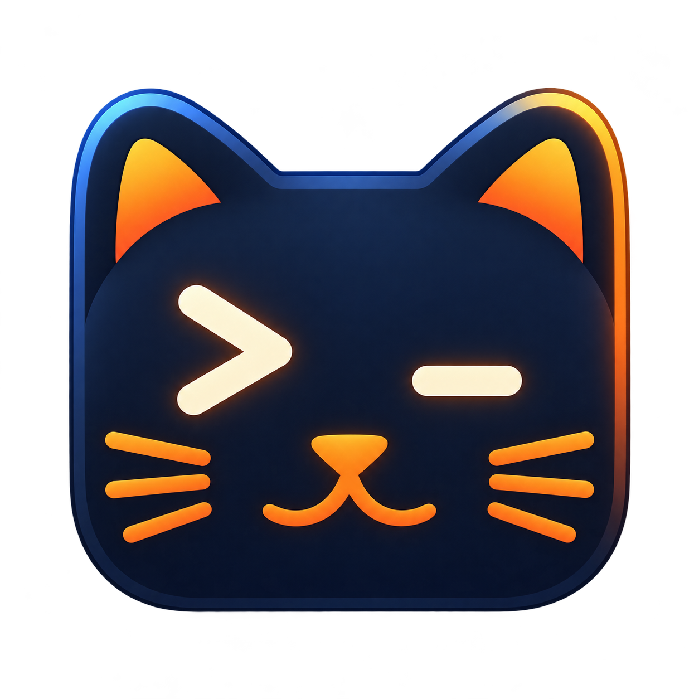

<p align="center"></p>

# AkiTTY

A **macOS-only terminal app revamped from [Ghostty](https://github.com/ghostty-org/ghostty)**,
with a Rust terminal core, native Swift/AppKit interface, and a small TypeScript
feature layer. No Zig compiler or runtime is required. Windows and Linux are not
application targets.

## Download

[Download AkiTTY 0.6.0 for Apple Silicon](https://download.automatosx.com/akitty/releases/download/v0.6.0/AkiTTY-0.6.0-macOS-arm64.zip)
(macOS 14+) or use the [GitHub release](https://github.com/defai-digital/akitty/releases/tag/v0.6.0).
Unzip and move **Akitty.app** to **Applications** before opening it.

Updates appear as a quiet, versioned titlebar reminder. **AkiTTY → Check for
Updates…** checks manually. Sparkle verifies signed feeds and update archives;
you choose when to install and restart. Automatic checks can be changed in Settings.

## What is implemented

- Native windows, tabs and split panes with interactive login shells; a visible
  **+** opens a new tab. Normal shell exit closes its pane, then any empty tab/window.
- Opening a folder (Finder **Open With**, a Dock drop, or `open -a Akitty <folder>`) starts
  a window whose tabs and splits begin in that folder; a file opens in its folder.
- Native **Settings… (⌘,)** for font/size, shell, starting directory, scrollback,
  Option-as-Alt and update checks. Appearance changes apply to open terminals;
  shell, directory and scrollback changes apply to new terminals.
- Rust-owned PTYs, bounded input, terminal parsing, configurable scrollback (5,000 lines by default), alternate
  screens, ANSI/truecolor output, Unicode cell widths and selection.
- CoreText text rasterization and Metal presentation, with visible software
  fallback when Metal fails. Snapshot processing and rasterization run off the UI thread.
- IME marked text, accessible terminal text/selection, text copy/paste, clipboard
  write approval, scrollback search and font-size controls.
- SGR and legacy mouse reporting; hold Option to select/scroll locally.
- A native command palette ranked by bundled TypeScript through JavaScriptCore.
  It adapts AX TUI's fuzzy ranking without importing its Zig-backed renderer.
- A versioned C ABI, explicit memory ownership, panic containment and tests across
  Rust, C, Swift and TypeScript.

**Status: early 0.6.0 implementation.** This is not a drop-in Ghostty replacement.
Kitty graphics, sixel, image clipboard protocols, Kitty keyboard extensions,
custom shaders, Ghostty configuration compatibility, shell integration, quick
terminal and third-party plugins are not implemented. Search currently finds the
latest literal match. Full external esctest qualification, VoiceOver user testing,
performance parity and testing on every supported Mac version remain separate work.

## Build and run

Requires macOS 14+, Xcode/Command Line Tools with Swift 6, rustup and Node 22+.
Rust 1.99.1 and dependency lockfiles are pinned. Build scripts select the rustup
compiler explicitly to avoid mixing in a different Homebrew Rust standard library.
Builds target the current Mac architecture.

```sh
rustup toolchain install 1.99.1 --profile minimal --component clippy --component rustfmt
scripts/build-app.sh release
open build/Akitty.app
```

For a development build, use `scripts/build-app.sh debug`. The app does not need
Node or npm at runtime. It starts your login shell in your home directory, or in
the Settings starting directory or an opened folder.

## Shortcuts

| Action | Shortcut |
| --- | --- |
| Settings | Command-Comma |
| New window / tab | Command-N / Command-T |
| Split / close pane | Command-D / Command-W |
| Command palette | Command-Shift-P |
| Copy / paste | Command-C / Command-V |
| Find in scrollback | Command-F |
| Font larger / smaller / reset | Command-Plus / Command-Minus / Command-0 |

Closing a live terminal asks for confirmation. Terminal-initiated clipboard reads
receive an empty reply; text writes require approval. Images are never decoded by
the clipboard confirmation path. Only the bundled, bounded TypeScript code runs;
it has no shell, filesystem or network bridge.

## Verification and distribution

```sh
scripts/verify.sh
```

The macOS workflow runs all behavioral tests, lint, cross-language ABI checks and
the public-file audit without suppressing failures. The curated conformance suite
is a required check; passing it is not a claim of full xterm/esctest conformance.

`AKITTY_FORCE_METAL_UNAVAILABLE=1` and `AKITTY_FORCE_SHADER_ERROR=1` exercise renderer
fallback when launching the executable directly. Software rendering remains usable.

Distribution signing and notarization use existing local credentials:

```sh
AKITTY_SIGNING_IDENTITY='Developer ID Application identity or certificate hash' \
AKITTY_NOTARY_PROFILE='existing-keychain-profile' scripts/notarize.sh
```

See [release and R2 delivery](docs/RELEASING.md) for the complete publication flow.

The script signs, submits to Apple, verifies acceptance, staples and assesses the
app, then writes `build/Akitty-macOS.zip`. Credentials and submission receipts are
never committed. This command does not publish a GitHub release.

## Acknowledgments and MIT license

AkiTTY is a revamp of **[Ghostty](https://github.com/ghostty-org/ghostty)**. We
acknowledge **Mitchell Hashimoto and the Ghostty contributors** for the original
project, its native terminal design, and the source used as the starting reference.
AkiTTY is an independent project, not an official Ghostty release.

AkiTTY's own code is **MIT licensed**; see [LICENSE](LICENSE). Original notices are
preserved for adapted code. Third-party dependencies retain their own licenses;
MIT does not relicense them. The Rust terminal engine is
[alacritty_terminal](https://github.com/alacritty/alacritty) (Apache-2.0).
The command-ranking adaptation comes from [AX TUI](https://github.com/defai-digital/ax-tui)
(MIT); see [provenance](third_party/ax-tui/NOTICE.md) and
[third-party notices](THIRD_PARTY_NOTICES.md).

The supplied [full logo](assets/logo.png) is retained; the
[Mac icon](assets/README.md) uses the cat emblem without the wordmark.
See [architecture and compatibility scope](docs/ARCHITECTURE.md) for the decisions.

Private agent instructions, `.internal`, raw reviews, credentials and machine paths
are excluded. `scripts/check_public.py` audits the exact Git index or committed tree
before publication, in addition to `.gitignore`.
