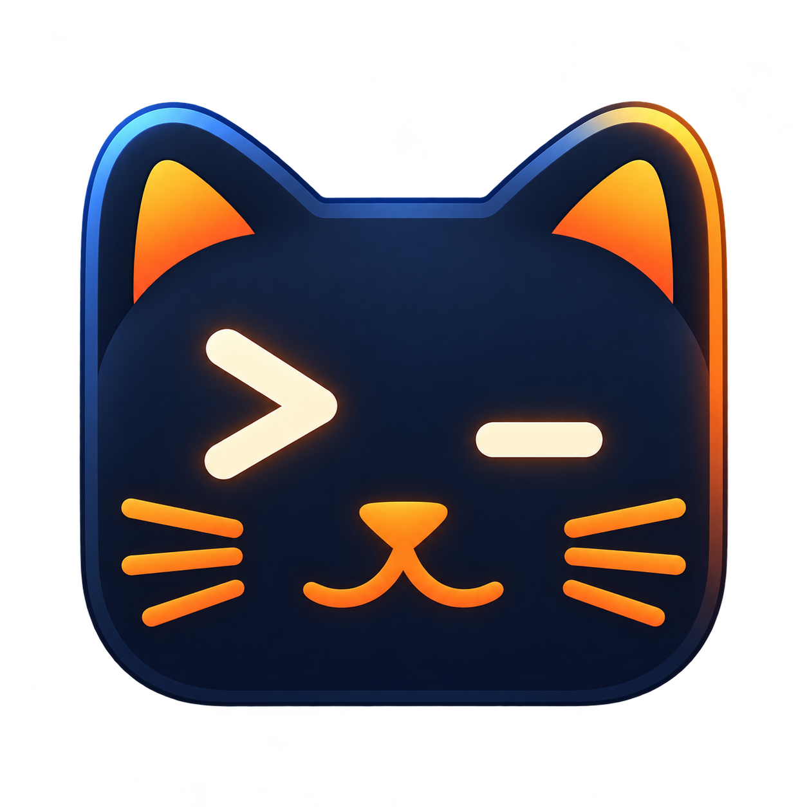
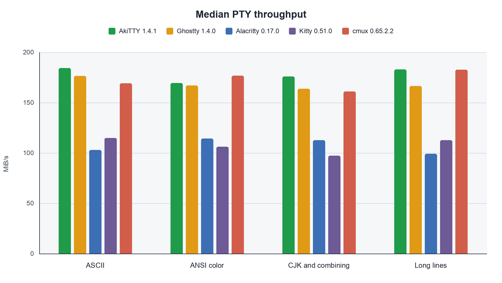

<p align="center"></p>

# AkiTTY

**A native macOS terminal for everyday shell work and AI coding agents.**

Organize projects in windows, tabs, and split panes. Find output across open
terminals, keep a quick terminal one shortcut away, and use Agent Overview to
see activity reported by your coding agents. When an agent sends AkiTTY a
supported request, you can review the exact command before approving it.

**Apple Silicon · macOS 27.2+ · MIT licensed**

[Install](#quick-start) · [Terminal features](#everyday-terminal-features) ·
[Agent integrations](#works-with-your-ai-agents) · [User guide](docs/USER_GUIDE.md) ·
[What's new in 2.2.1](docs/releases/2.2.1.md)

## Quick start

Download **AkiTTY 2.2.1** for Apple Silicon, unzip it, and move **Akitty.app**
to Applications. [Download ZIP](https://github.com/defai-digital/akitty/releases/download/v2.2.1/AkiTTY-2.2.1-macOS-arm64.zip) ·
[Latest release](https://github.com/defai-digital/akitty/releases/latest)

Or use the installer. It verifies the checksum, code signature, and
notarization before installing the app in **~/Applications**.

```sh
curl -fsSL https://download.automatosx.com/akitty/install -o install.sh
bash install.sh
open "$HOME/Applications/Akitty.app"
```

Use **⌘T** to open a tab, **⌘D** to split a pane, or **⌘,** to open Settings.
Choose **Akitty → Check for Updates…** to check manually. For a system-wide
installation, run `bash install.sh --system` with write access to **/Applications**.

<a id="what-is-implemented"></a>

## Everyday terminal features

| When you want to… | Use… |
| --- | --- |
| Keep several tasks in view | Open windows and tabs, split a tab into side-by-side panes, or drag a tab to another window with its running shells. |
| Find output you saw earlier | Use **⌘F** in the current pane or **⌥⌘F** to search retained output across open terminals and jump to a match. |
| Open a shell with project settings | Save a profile with its own font, colours, shell, starting folder, and scrollback under **Settings → Profiles**. |
| Return to a workspace | Save named window layouts with **Shell → Window Layouts**. Reopening starts fresh shells. You can include a short scrollback excerpt when saving. |
| Reach a shell from another app | Enable the global shortcut in **Settings → Keyboard**. Hiding the Quick Terminal keeps its shells running. |
| Find an app command | Press **⇧⌘P** to open the command palette. |

<a id="folder-command-history"></a>

AkiTTY supports truecolor, alternate screens, CJK fonts, IME input, hyperlinks,
and Kitty graphics and keyboard features. Native rendering uses CoreText and
Metal with a software fallback. Settings include paste and clipboard-write
confirmation. [Terminal user guide](docs/USER_GUIDE.md) ·
[Folder-aware zsh history](docs/USER_GUIDE.md#folder-aware-command-history) ·
[Compatibility](docs/COMPATIBILITY.md)

<a id="agent-protocols"></a>

## Works with your AI agents

Run your usual agent CLI inside an AkiTTY pane. **Akitty → Agent Integrations…**
shows which CLIs it found and offers setup for these workflows.

| Agent | What AkiTTY can show or approve |
| --- | --- |
| Claude Code and Codex | Reported conversations and supported Bash permission prompts. **Allow Once** returns the decision to the agent, which runs the command under its own policy. |
| AX Code, Grok, Muse Code, Kimi Code, and AGY | Reported conversations and explicit MCP requests to run a command in an AkiTTY pane. **Run Command** queues the approved command in that pane's shell. |

[Client-specific setup](docs/AGENT_NATIVE.md#agent-integrations) ·
[MCP setup for other clients](docs/MCP.md)

<a id="why-akitty"></a>
<a id="30-second-tour"></a>

## Try the agent workflow

1. **Connect.** Install the integration for your CLI, restart the agent, and
   choose **Akitty → Enable Local Agent Requests**.
2. **Observe.** Open **Window → Agent Overview** (**⌥⌘A**) to see reported
   activity, input ownership, and queued approvals. Use **Show Terminal**
   to jump to a pane.
3. **Approve or deny.** When a request arrives, review the exact command and its
   target in the native sheet. **Deny** is selected by default.
4. **Reclaim and inspect.** After approving a command sent to a pane, use
   **Edit → Reclaim Terminal Control** to return input to yourself. Running
   commands continue. Use **Akitty → Agent Event Timeline…** to inspect local
   event metadata.

Approval covers requests submitted to AkiTTY. The agent's ordinary subprocesses
and file operations use its existing permissions. Check the terminal for a
command's result after AkiTTY queues it.

AkiTTY can also reopen your windows and offer to resume the conversation last
reported in each pane. Turn this on in **Shell → Window Layouts**.
[Try an approval with the bundled companion](docs/AGENT_NATIVE.md#request-a-command-from-a-local-agent) ·
[Resume conversations](docs/AGENT_NATIVE.md#reopen-windows-and-resume-agent-conversations)

## Siri and Shortcuts

Try **“Show agents in AkiTTY”** or **“Show the quick terminal in AkiTTY.”**
The Shortcuts app also has actions for opening folders, managing panes, and
requesting a command for review in AkiTTY. These actions require local device
authentication. [Setup and all ten actions](docs/SIRI.md)

<a id="shortcuts"></a>

## Documentation

| What you need | Guide |
| --- | --- |
| Set up a workspace, search, or change preferences | [User guide](docs/USER_GUIDE.md) |
| Set up a CLI, review requests, or resume a conversation | [Native agent workflows](docs/AGENT_NATIVE.md) · [Approval demo](docs/AGENT_DEMO.md) |
| Use the keyboard or VoiceOver | [Shortcuts](docs/USER_GUIDE.md#keyboard-shortcuts) · [Accessibility](docs/ACCESSIBILITY.md) |
| Connect a client or add program status | [Local MCP bridge](docs/MCP.md) · [Program SDK](packages/akitty-sdk/README.md) |
| Check terminal support and how it was tested | [Compatibility](docs/COMPATIBILITY.md) · [Roadmap](docs/ROADMAP.md) |
| Understand how AkiTTY is built | [Architecture](docs/ARCHITECTURE.md) · [C ABI](docs/ABI.md) · [Contributing](CONTRIBUTING.md) |

## Windows and Linux

The installable AkiTTY app is for macOS. AkiTTY Web is a private source package
used by AX Code Desktop. It runs in a browser on Windows, Linux, and macOS with
the shared Rust VT engine compiled to WebAssembly. The embedding host starts
the shell and connects its PTY to the terminal.
[AkiTTY Web integration guide](packages/akitty-web/README.md)

<a id="macos-pty-throughput"></a>

## Performance

AkiTTY 2.1.4 was measured on 2026-11-20. The other four columns use the
2026-11-19 comparison. Each rate uses the median elapsed time across 45 real
PTY samples, from the first payload write through the terminal's reply to a
trailing cursor-position request.



| Workload (median MiB/s) | AkiTTY 2.1.4 | Ghostty 1.4.0 | Alacritty 0.17.0 | Kitty 0.51.0 | cmux 0.65.2.2 |
| --- | ---: | ---: | ---: | ---: | ---: |
| ASCII | 208.1 | 176.5 | 102.9 | 115.0 | 169.1 |
| ANSI color | 216.0 | 167.0 | 114.3 | 106.2 | 176.7 |
| CJK and combining text | 213.5 | 163.7 | 112.8 | 97.2 | 161.2 |
| Long lines | 210.2 | 166.5 | 99.3 | 112.7 | 182.6 |

Both sessions used the same Apple M3 Max with macOS 27.2.1, hidden apps,
a 98×25 PTY grid and scrollback limits set to zero.
[App benchmark method and raw data](docs/PERFORMANCE.md#macos-pty-throughput)

The headless engine benchmark feeds bytes directly into the parser and grid.
It includes AkiTTY 1.4.1, libghostty-vt, Alacritty and Kitty.
[Headless engine results](docs/PERFORMANCE.md#reference-engine-throughput)

## Build and run

Source version **2.2.1** requires Apple Silicon, macOS 27.2+, Xcode 27.2,
Rust 1.99.1 and Node 22.18+. See the contributor guide for the repository layout
and focused development commands. [Contributing](CONTRIBUTING.md)

```sh
rustup toolchain install 1.99.1 --profile minimal --component clippy --component rustfmt --target wasm32-unknown-unknown
scripts/build-app.sh release
open build/Akitty.app
```

### Verification and distribution

```sh
scripts/verify.sh
```

The gate covers Rust, Swift, TypeScript, WebAssembly, ABI compatibility,
browser tests and release tooling. [Verification and build details](CONTRIBUTING.md#build-and-test) ·
[Signing and publication](docs/RELEASING.md) · [Unreleased changes](docs/releases/unreleased.md)

## Acknowledgments and MIT license

AkiTTY's code is MIT licensed. The native and web terminals use the
independently authored `akitty-vt` engine. Thanks to the Ghostty, Alacritty
and VTE contributors for earlier engines and design references, and to iTerm2
and Kitty for architectural ideas and protocol work. [License](LICENSE) ·
[Engine provenance](third_party/TERMINAL_ENGINE.md) · [Third-party notices](THIRD_PARTY_NOTICES.md)
